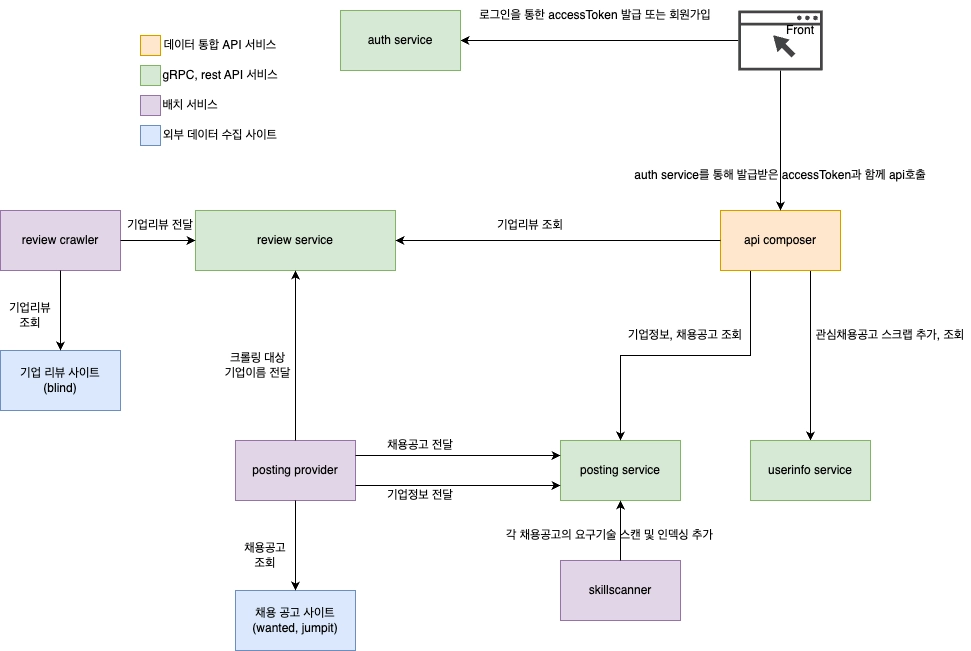

# jyoliar-careerhub

채용 공고는 Wanted 와 JumpIt 에 따로 있고, 그 회사의 평판은 또 다른 사이트에서 찾아야 했다. \
공고를 한 자리에 모으고 그 회사의 리뷰와 요구 기술을 옆에 붙여 보는 도구를 직접 쓰려고 만들었다. \
동시에 gRPC · 서비스 분리 · 배치 · Kubernetes 를 글이 아니라 운영으로 겪어 보려는 목적이 컸다. \
처음에는 AWS 에 올렸지만 사이드 프로젝트가 감당할 비용이 아니어서 라즈베리파이 홈랩으로 옮겼고, 클라우드는 홈랩이 혼자 할 수 없는 것만 맡는다. \
지금 공개된 것은 레거시 careerhub 이고, 인증을 Zitadel 로 위임하는 리뉴얼이 진행 중이다.

## 서비스 구조

현재 공개된 레거시 careerhub 의 흐름이다. \
보안 강화를 위해 자체 로그인(auth service)은 인터넷에서 막았고, 인증을 Zitadel 로 위임하는 리뉴얼이 진행 중이다. \
그래서 그림의 "로그인을 통한 accessToken 발급" 화살표만 지금과 다르다.

**데이터 통합 API** — 프런트가 부르는 유일한 입구다.

- **api composer** — REST 로 받은 요청을 뒤의 서비스들에 gRPC 로 흩어 보내고 한 응답으로 합친다. 공고 · 기업 정보 · 기업 리뷰 · 관심 공고 스크랩이 여기서 모인다.

**gRPC · REST 서비스** — 각자 자기 데이터만 가진다.

- **posting service** — 채용 공고와 기업 정보를 저장 · 조회한다. 배치가 넣어 준 요구 기술 색인을 함께 가진다.
- **review service** — 기업 리뷰를 저장 · 조회한다.
- **userinfo service** — 사용자의 관심 공고 스크랩을 저장 · 조회한다.
- **auth service** — 레거시 로그인 · 회원가입. 지금은 인터넷에서 닿지 않는다.

**배치 서비스** — 외부 사이트에서 수집해 서비스에 넣는다.

- **posting provider** — Wanted · JumpIt 의 공고와 기업 정보를 posting service 에 전달하고, 리뷰를 수집할 기업 이름을 review service 에 전달한다.
- **skillscanner** — 각 공고의 요구 기술을 스캔해 posting service 의 색인에 더한다.
- **review crawler** — TeamBlind 의 기업 리뷰를 review service 에 전달한다.

**저장소와 프런트.** \
공고 · 리뷰 · 사용자 데이터는 MongoDB 에, 인증(auth service · Zitadel)은 PostgreSQL 에 있다.

## 인프라 구조

서비스와 데이터는 전부 홈랩에 있다. \
클라우드는 홈랩이 혼자 할 수 없는 것만 맡는다 — 신뢰의 뿌리 · 비밀 보관 · 오프사이트 백업 · 이미지 레지스트리 · 빌드 러너 · DNS 와 엣지. \
클라우드 쪽은 Terraform 이 만들고(seed), 홈랩의 GitOps 저장소가 소비한다. \
방향은 한쪽이다 — Terraform 은 클러스터 안의 산출물을 알지 못하고, 클러스터는 Terraform 의 산출물을 Parameter Store · IAM Role · S3 · 터널 자격증명으로만 받는다.

### 홈랩(온프레미스)

라즈베리파이(arm64) 여러 대로 만든 Kubernetes 클러스터다. \
컨트롤 플레인은 복수이고 etcd 는 컨트롤 플레인 노드에 같이 산다(stacked). \
노드와 클러스터 하부는 Ansible 이 세운다 — OS 준비 · CRI-O · kubeadm · 방화벽 · kube-vip · Secret 암호화 · 스토리지 디스크 준비. \
컨트롤 플레인 VIP 와 LoadBalancer 서비스의 IP 풀은 kube-vip 가 맡는다. \
kubelet 의 서빙 인증서는 CSR 로 받고 kubelet-csr-approver 가 승인한다.

클러스터 안은 전부 GitOps 저장소에서 온다. \
Argo CD 가 ApplicationSet 하나로 bootstrap → controllers → system → services 순서를 강제해 동기화한다. \
Argo CD 보다 먼저 있어야 하는 것(External Secrets · csr-approver · Longhorn · metrics-server)만 helmfile 로 깐다. \
배포는 GitOps 저장소에서 이미지 태그를 PR 로 올리면 Argo CD 가 반영한다 — 클러스터를 고치는 길은 PR 뿐이다.

| 영역 | 컴포넌트 |
|---|---|
| 서비스 · 배치 | careerhub 서비스 전부 — Deployment 와 CronJob |
| 스토리지 | Longhorn — 노드의 NVMe 를 복제해 PersistentVolume 으로 |
| 데이터베이스 | MongoDB(operator 의 ReplicaSet) · PostgreSQL(CloudNativePG) |
| 트래픽 | NGINX Gateway Fabric(Gateway API) — 사설 Gateway 는 kube-vip IP 로, 공개 Gateway 는 ClusterIP 로 두고 터널만 받는다 |
| 인증서 · DNS | cert-manager 와일드카드 인증서 · external-dns 가 Gateway 의 호스트를 Cloudflare 에 등록 |
| 시크릿 | External Secrets Operator — AWS Parameter Store 에서 받아 Secret 으로 만든다. AWS 키는 없다 |
| 신뢰의 발급자 | apiserver 가 ServiceAccount 토큰의 OIDC 발급자다. 그 공개키(JWKS)를 작은 nginx 가 터널을 통해 공개 호스트로 서빙한다 |
| 터널 클라이언트 | cloudflared — 클러스터에서 Cloudflare 로 나가는 연결 하나가 공개 경로의 전부다 |
| 인증 | Zitadel(IdP) — 리뉴얼의 인증 |
| 관측 | kube-prometheus-stack(Prometheus · Alertmanager · Grafana) · Loki · Tempo · Alloy. promcheck 가 "데이터 원천이 없는 알럿 룰" 을 상시 검사한다. 알림은 Discord |
| 운영자 접근 | Tailscale Subnet Router — 홈랩 대역을 tailnet 에 광고한다. 공인 IP · 포트포워딩은 없다 |

컨테이너 이미지는 전부 arm64 네이티브로 빌드한다.

### AWS

홈랩이 믿을 뿌리와 홈랩 밖에 있어야 안전한 것들이 있다. \
전부 Terraform 이 만든다.

| 무엇 | 역할 | 홈랩이 닿는 길 |
|---|---|---|
| IAM OIDC Provider · IRSA 역할 | 클러스터의 OIDC 발급자를 신뢰하고, ServiceAccount 토큰을 AWS 자격증명으로 바꾼다. 역할은 셋 — External Secrets · ECR pull · PostgreSQL 백업 | 노드에도 Secret 에도 장수명 AWS 키가 없다. 파드가 자기 ServiceAccount 토큰으로 역할을 맡는다 |
| Parameter Store | Google OAuth 클라이언트 · Zitadel masterkey · 알림 webhook · DNS 토큰 같은 비밀의 원본 | External Secrets Operator 가 IRSA 로 읽는다 |
| S3 버킷 | PostgreSQL 의 지속 백업 | CloudNativePG 가 IRSA 로 쓴다. 복구용 클러스터 정의도 같은 버킷을 신뢰한다 |
| ECR | 서비스 이미지 레지스트리 | 클러스터의 pull 자격증명은 IRSA 로 주기적으로 갱신되는 토큰이다 |
| CodeBuild | GitHub Actions 의 ARM self-hosted runner — 홈랩과 같은 아키텍처로 빌드한다 | 홈랩은 닿지 않는다. GitHub Actions 가 부른다 |

### Cloudflare

도메인과 공개 경로의 입구다. \
zone · 터널 · 엣지 보호는 Terraform 이 만들고, careerhub 의 DNS 레코드는 클러스터의 external-dns 가 자동으로 만든다.

| 무엇 | 역할 |
|---|---|
| DNS zone | 도메인의 권위 서버. OIDC 발급자 호스트의 CNAME 도 여기 있다 |
| Tunnel | 클러스터의 cloudflared 가 밖으로 연 연결. 공인 IP · 포트 없이 공개 Gateway 까지 트래픽을 넣는다. 터널 자격증명은 Terraform 출력을 사람이 Secret 으로 옮긴다 |
| 엣지 보호 | 레이트리밋 · AI 봇 차단 · HTTPS 강제 · TLS 하한 · HSTS. 대시보드 토글이 아니라 Terraform 리소스다 |

공개 경로는 인터넷 → Cloudflare 엣지 → Tunnel → 클러스터 안 cloudflared → 공개 Gateway → 서비스다. \
공개 Gateway 는 네임스페이스 전용이고 ClusterIP 라, 사설 Gateway 와 Zitadel 관리면은 밖에서 닿지 않는다.

### GitHub Actions

서비스 저장소의 CI 다. \
인프라 저장소 셋에는 GitHub Actions 가 없다 — Terraform 은 Terraform Cloud 가, 클러스터는 Argo CD 가 반영한다.

- **머지 게이트** — PR 과 prod 브랜치 push 마다 돈다. 순서는 계약 신선도 → 빌드 → 테스트다.
  - 계약 신선도: 명세(OpenAPI 또는 proto)에서 코드를 다시 생성해 커밋된 생성물과 diff 가 있으면 거부한다. 명세와 구현이 어긋난 채로는 머지되지 않는다.
  - 빌드와 테스트: `go build` · `make test`.
- **계약 공표** — 계약 파일이 바뀐 PR 에서는 좌표를 검사하고, prod 에 머지되면 태그를 찍는다.
  - REST(api-composer · auth-service): `openapi.yaml` 의 `info.version` 을 읽어 `spec/<이름>/vX.Y.Z` 태그를 만든다.
  - gRPC(posting · review · userinfo): `api/<모듈>/VERSION` 을 읽어 계약 모듈마다 태그를 만든다.
  - 이미 공표된 좌표를 다른 내용으로 다시 쓰는 PR 은 거부한다 — 한 좌표는 한 계약 내용이다. 소비자는 이 불변 태그에 핀한다.
- **이미지 빌드와 push** — `v*` 태그를 push 하면 돈다.
  - 서비스 저장소의 워크플로는 조직 공용 재사용 워크플로(`.github` 저장소)를 부르는 몇 줄뿐이다.
  - 러너는 AWS CodeBuild 의 ARM self-hosted runner 다 — `runs-on` 라벨로 CodeBuild 를 띄우고, 빌더 이미지와 인스턴스 크기는 입력으로 정한다. 홈랩과 같은 아키텍처라 에뮬레이션이 없다.
  - Docker 빌드 뒤 ECR 에 push 한다. 이미지 태그는 git 태그 그대로다. private 의존 모듈을 받는 토큰은 BuildKit secret 으로만 넘겨 이미지 레이어에 남지 않는다.

## 저장소

### 인프라 저장소

| 저장소 | 층 | 담는 것 | 받는 것 |
|---|---|---|---|
| onpremise-k8s ([공개 예정](https://github.com/jyoliar-lab/ops-workflow/issues/73)) | 노드 · 클러스터 하부 | Ansible — OS 준비부터 kubeadm 클러스터 · kube-vip · Secret 암호화 · 스토리지 디스크 준비 · 업그레이드 · Tailscale Subnet Router | — |
| [jyoliar-k8s](https://github.com/jyoliar-careerhub/jyoliar-k8s) | 클러스터 안 | Argo CD GitOps — 플랫폼 컴포넌트 · 관측 · 데이터베이스 · careerhub 서비스 배포 | 클러스터(onpremise-k8s) · Parameter Store · IAM Role · S3 · ECR · 터널 자격증명(jyoliar-platform-terraform) |
| [jyoliar-platform-terraform](https://github.com/jyoliar-careerhub/jyoliar-platform-terraform) | 클라우드 seed | Terraform — IAM OIDC Provider 와 IRSA 역할 · Parameter Store · S3 백업 버킷 · CodeBuild 러너와 ECR · Cloudflare zone · 터널 · 엣지 보호 | OIDC 발급자 호스트(onpremise-k8s 의 클러스터 설정) |

### 애플리케이션 저장소

| 저장소 | 그림에서 | 역할 |
|---|---|---|
| [careerhub-front](https://github.com/jyoliar-careerhub/careerhub-front) | 프런트 | 레거시 프런트 — Svelte |
| [careerhub-web](https://github.com/jyoliar-careerhub/careerhub-web) | — | 리뉴얼 프런트 — Next.js · Zitadel 로그인. 아직 배포 전이다 |
| [careerhub-api-composer](https://github.com/jyoliar-careerhub/careerhub-api-composer) | api composer | 데이터 통합 API — REST 입구, 뒤의 서비스에 gRPC 로 흩어 보낸다 |
| [careerhub-posting-service](https://github.com/jyoliar-careerhub/careerhub-posting-service) | posting service | 채용 공고 · 기업 정보 · 요구 기술 색인 |
| [careerhub-review-service](https://github.com/jyoliar-careerhub/careerhub-review-service) | review service | 기업 리뷰 |
| [careerhub-userinfo-service](https://github.com/jyoliar-careerhub/careerhub-userinfo-service) | userinfo service | 관심 공고 스크랩 |
| [auth-service](https://github.com/jyoliar-careerhub/auth-service) | auth service | 레거시 로그인 · 회원가입. 인터넷에서 닿지 않는다 |
| [careerhub-posting-skillscanner](https://github.com/jyoliar-careerhub/careerhub-posting-skillscanner) | skillscanner | 배치 — 공고의 요구 기술을 스캔해 색인에 더한다 |
| careerhub-posting-provider | posting provider | 배치 — Wanted · JumpIt 수집. 비공개 |
| careerhub-review-crawler | review crawler | 배치 — TeamBlind 리뷰 수집. 비공개 |

수집 배치 둘은 공개하지 않는다 — 코드가 퍼지면 수집 대상 사이트에 뜻하지 않은 부하를 줄 수 있다.
